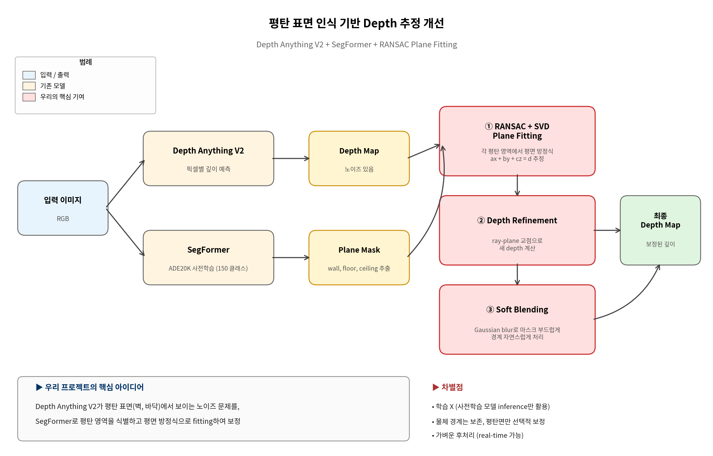

# 선반 기하 구조 인지 기반 RANSAC 후처리를 통한 단안 Depth 추정 개선

Geometry-Aware Monocular Depth Refinement for Planar Shelf Structures via RANSAC-based Post-processing

2026년 1학기 컴퓨터 비전 수업의 2인 팀 프로젝트입니다. 결과를 논문 형식의 최종 보고서로 정리했습니다.

- 최종 보고서: [paper/final_report.pdf](paper/final_report.pdf)
- 발표자료: [paper/slides.pdf](paper/slides.pdf)
- 제안서: [paper/proposal.pdf](paper/proposal.pdf)



## 문제

사진 한 장으로 깊이를 추정하는 Depth Anything V2는 선반처럼 무늬가 적고 평평한 표면에서 깊이 값이 불규칙하게 흔들립니다. 물류 로봇이나 진열 인식처럼 선반을 다루는 곳에서는 이 오차가 충돌이나 집기 오류로 이어질 수 있습니다.

## 방법

모델을 다시 학습시키지 않고, 추정된 깊이 지도를 후처리합니다.

1. Depth Anything V2로 기본 깊이 지도를 만든다.
2. 선반 테두리 영역을 가로 판과 세로 기둥 그룹으로 나눈다.
3. 그룹마다 따로 RANSAC + SVD로 평면을 맞춘다.
4. 검사를 통과한 픽셀만 평면에 맞춰 보정한다.
5. Guided Filtering으로 경계를 보존하면서 원래 깊이와 섞는다.

가로 판은 세로 기둥보다 안쪽에 있어서 둘은 같은 평면이 아닙니다. 하나의 평면으로 합쳐 맞추면 깊이 차이가 왜곡되기 때문에, 가로와 세로를 나눠서 맞추는 것이 이 방법의 핵심입니다.

## 결과

iBims-1의 레이저 스캐너 정답과 비교한 결과입니다. 두 지표 모두 줄어드는 쪽이 개선입니다.

| 장면 | AbsRel 변화 | Plane RMSE 변화 |
|---|---|---|
| storageroom_08 | −16.1% | −18.9% |
| meetingroom_07 | −2.4% | −23.4% |
| storageroom_01 | −12.6% | −4.8% ~ −11.2% |

meetingroom_07은 정답 기준 개선폭이 작았지만, 평면이 얼마나 평평하게 복원됐는지를 보는 보조 지표는 세 장면 모두 좋아졌습니다.

## 한계

- 사진에 초점 거리 정보가 없어서 카메라 파라미터를 추정값으로 썼습니다.
- 얇은 선 모양의 영역은 픽셀 수가 적어 RANSAC이 불안정합니다.
- 장면마다 사진 1장으로 실험해서 통계적으로 일반화하기 어렵습니다.
- 영역을 묶는 방식끼리의 정량 비교는 하지 못했습니다.

## 폴더

```
paper/       최종 보고서, 발표자료, 제안서
notebooks/
  01_plane_refinement_pipeline.ipynb   평면 보정 파이프라인 (직접 찍은 사진으로 실험)
  02_ibims1_gt_evaluation.ipynb        iBims-1 정답 기준 평가
figures/     파이프라인 그림
```

iBims-1 데이터셋은 이 저장소에 없습니다.
